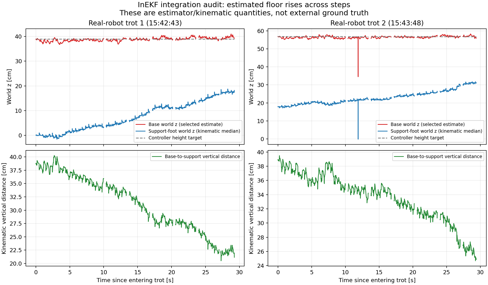

# 真机 InEKF 高度漂移与估计器接入排查

数据来自 2026-10-25 15:42:11 启动的真机进程 37474，共 14 个 `/tmp/trotting_debug_37474_*.csv`，按 `ros_s` 去重后 13,514 行。该进程日志加载的是 `Sysu219System`，不是 Gazebo。

## 已观测到的现象

以下为进入 Trotting 后 0–0.5 秒与 27–29.5 秒窗口的中位数，单位 cm。

| 项目 | 第一段开始 | 第一段末尾 | 第二段开始 | 第二段末尾 |
| --- | ---: | ---: | ---: | ---: |
| 主算法接收的机身世界系 z | 38.76 | 39.58 | 56.64 | 56.92 |
| 控制器高度目标 | 38.91 | 38.91 | 56.83 | 56.82 |
| 支撑足世界系 z 的中位数 | -0.05 | 17.43 | 17.82 | 30.81 |
| 机身到支撑足的竖直距离 | 38.79 | 22.07 | 38.84 | 26.21 |

“支撑足”在这里依据步态接触先验选择，足端坐标来自姿态和腿部运动学，未使用实测接触力。上述数值不是外部运动真值。机身世界系 z 被闭环维持在目标附近，并不能据此否定实际机身高度、姿态或运动发生明显变化。

世界系地面基准持续上升；再次进入 Trotting 时，已经漂移的估计 z 又被保存为新的高度目标。

15:44:00.770 左右，还记录到估计器超时回退造成的坐标跳变：

| 项目 | 回退前 | 回退帧 | 下一帧 |
| --- | ---: | ---: | ---: |
| 世界系机身 z / cm | 56.195 | 34.518 | 56.220 |
| 机身到支撑足竖直距离 / cm | 34.685 | 34.691 | 34.689 |

该时刻存在对应的 `[ODOMETRY]` 回退告警。高度基准跳变约 21.7 cm，而相对运动学高度基本连续。

## 代码和日志证据

1. 旧 KF 持续使用支撑足高度观测；修改前的新 InEKF 只在初始化时定义地面高度。后续触地锚点直接由当前机身估计位置和运动学生成，没有固定平地高度参考，因此已有竖直误差能够被带入下一步。支撑足随机游走和自适应降权也允许锚点发生变化。
2. 启动日志显示固定站立期间一直没有步态支撑先验；新滤波器直到开始行走后约一秒才以 `MOVING BOOTSTRAP (BIAS UNCERTAIN)` 初始化。该路径把初始惯性零偏设为零，没有完成站立零偏初始化。
3. 修改前的接入每周期先默认选择旧 KF，新结果通过新鲜度检查才覆盖输出。发生超时时，直接返回到高度基准不同的旧 KF，造成上述瞬间跳变。

现有 CSV 没有保存新滤波器完整零偏、锚点协方差与每周期来源标记，不能据此唯一分解加速度误差、接触误差和零偏各自的贡献。`acc_G`、`v_predicted`、`v_unfiltered` 仍是旧 KF 的诊断量。

## 本轮源码修改

- 估计来源由源码开关在激活时固定，删除新旧系统之间的自动回退；保留用户当前 `kUseInEKFOdometry = true`。
- 两套滤波状态各自更新，旧 KF 仅提供独立对照。新系统的初始化、传播与校正不使用旧 KF 的状态；旧状态只参与显示及初始原点差诊断。
- 新系统在固定站立阶段取得独立的支撑先验，并要求完成静止候选初始化；去掉一秒后强制运动初始化的路径。
- 新系统未就绪时不允许进入依赖它的运动状态；运行中失效返回控制器错误，不切换旧 KF。短时缺帧仅复用新系统自身的结果，结果年龄上限 100 ms。
- 给可靠支撑足加入平地 z=0 软观测，标准差起始值为 1 cm，并按接触过渡可信度调整。保留水平滑移自由度，未固定机身高度或机身速度。

## 验证范围

只进行了源码静态检查和离线数学检查，没有编译、启动机器人或验证修改后的真机效果。

平地观测的右不变误差雅可比经 80 组有限差分检查，最大误差约 2.16e-10；复用三维校正接口与标量卡尔曼更新的数值差为零；检查样本中 Joseph 更新后的协方差保持正定。静态检查确认仅修改五个估计器及主控制器接口文件，未改 MPC、WBC 或各 FSM 状态实现文件。

cppcheck 对工程原有的字符串临时对象 `+=` 表达式存在解析限制；主控制器使用仅展开这一表达式的临时静态副本检查，原源码表达式未修改。
